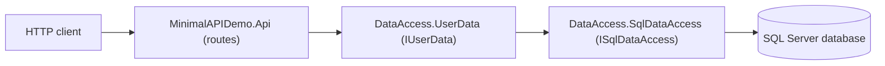

# Architecture — MinimalAPIDemoApp

This repo has two components and a non-trivial (layered DI) data flow from HTTP request
down to the database, so it gets a dedicated architecture doc even though it is small.

## Diagram

## Components

- **MinimalAPIDemo** — ASP.NET Core Minimal API host. Defines the `/Users` HTTP routes
  in `Api.cs`, wires dependency injection in `Program.cs`, and translates results/errors
  from the data layer into HTTP responses.
- **DataAccess** — class library. `UserData` implements `IUserData` and knows the
  application's stored-procedure names; `SqlDataAccess` implements `ISqlDataAccess` as a
  generic Dapper wrapper (any stored procedure name/parameters) and reads the connection
  string from configuration.

## Data flow

An HTTP request hits a route in `Api.cs`, which calls a method on the injected
`IUserData` (`UserData`). `UserData` calls `ISqlDataAccess` (`SqlDataAccess`) with a
specific stored-procedure name (e.g. `dbo.spuGetAll`) and parameters. `SqlDataAccess`
opens a `SqlConnection` using `ConnectionStrings:Default` and executes the stored
procedure via Dapper, returning mapped `UserModel` results back up the same chain to the
HTTP response.

## External integration points

- **SQL Server database** — the sole external dependency. All reads/writes go through
  stored procedures (`spuGetAll`, `spuGet`, `spuInsert`, `spuUpdate`, `spuDelete`)
  defined in the `TestDB`/`UserDB` SQL projects against a single `dbo.User` table.

## Operational notes / gotchas

- `ConnectionStrings:Default` must be correctly configured (locally via
  `appsettings.Development.json`/user-secrets, never committed) or every data operation
  fails at the `SqlDataAccess` layer.
- Stored-procedure names are hardcoded in `DataAccess/Data/UserData.cs`
  (`dbo.spuGetAll`, `dbo.spuGet`, `dbo.spuInsert`, `dbo.spuUpdate`, `dbo.spuDelete`) and
  must match the procedures actually deployed to the target database — `SqlDataAccess`
  itself is generic and does not encode any procedure names.

---
schema_version: 1.0.0
distilled_from_sha: 1551ac32a1a7c0f675f6d14bf3f94d4ba046a692
verified_sha: 1551ac32a1a7c0f675f6d14bf3f94d4ba046a692
verified_at: 2026-08-16T18:34:13Z
